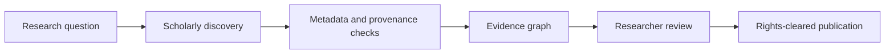

# Research system architecture

Conceptual public overview, not a disclosure of private implementation.

The original project documentation describes Crossref and OpenAlex discovery, research assistance, manuscript screening and moderated scholarly deposits. Evidence Atlas is represented here as a design concept; this showcase does not establish that the complete graph implementation is deployed. Metadata checks do not prove scientific validity or guarantee indexing. Private algorithms, credentials, manuscripts and infrastructure are excluded.
